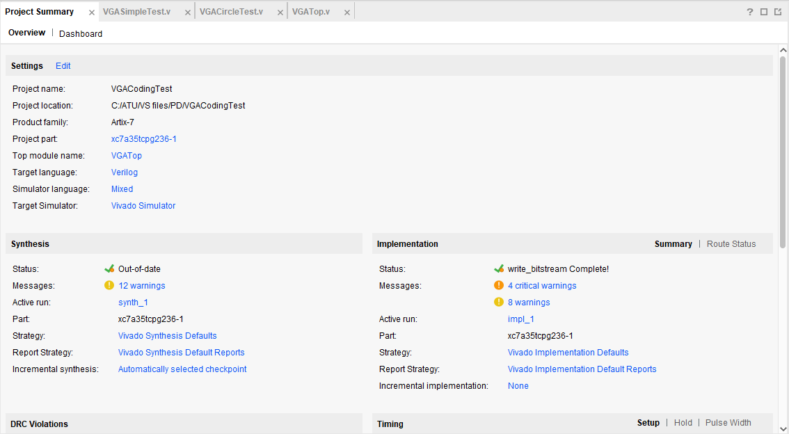
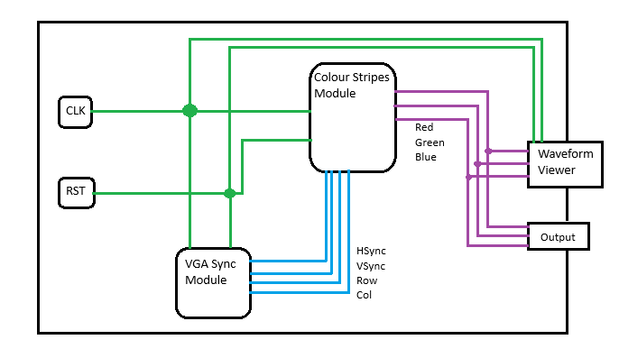
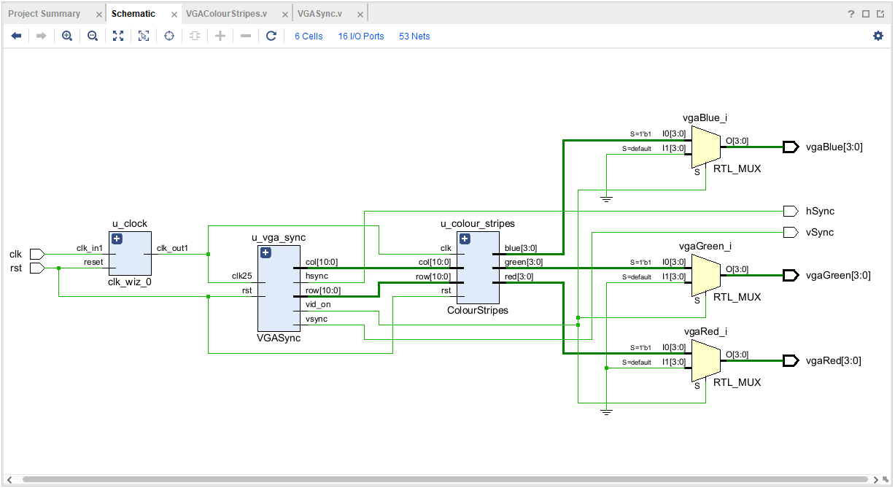
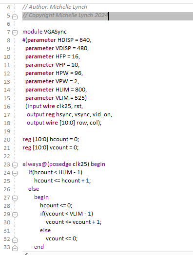
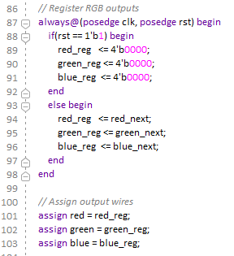
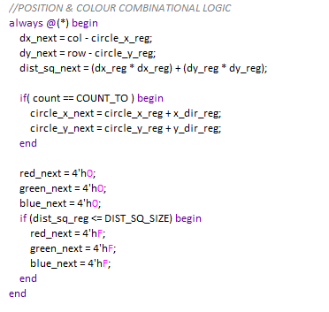
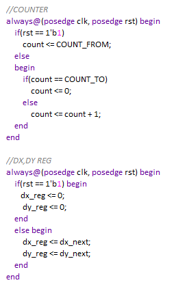
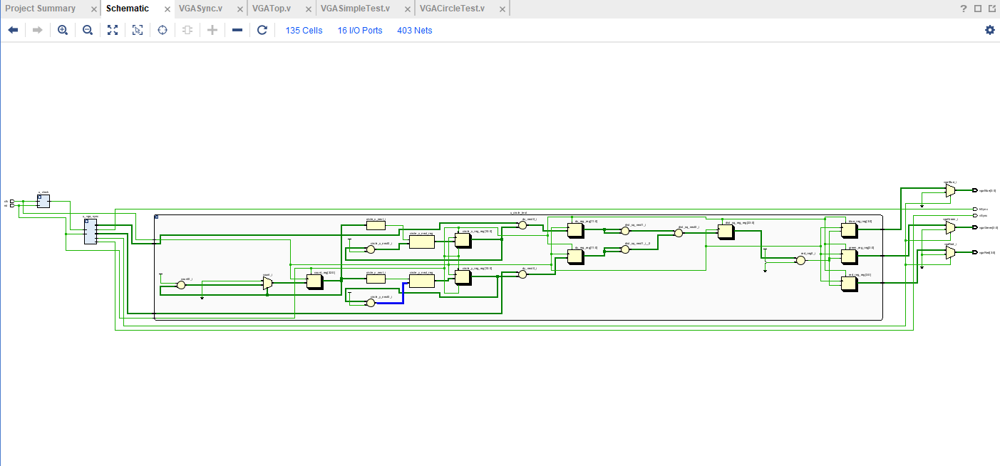
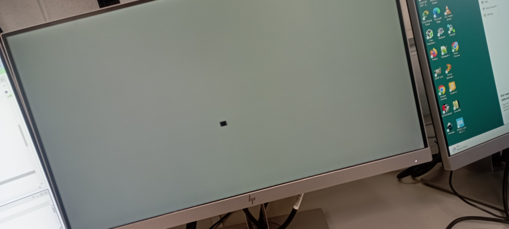

# Project Synopsis

Welcome to my development page for my project. This is a project to adapt an FPGA VGA driver to display graphics on to a display. I will be attempting to create a simple version of the DVD logo through Vivado, and will be going through the FPGA workflow that follows.

The plan is to put a custom image of my design onto a display with a VGA cable, powered by FPGA code.

[Add a short welcome message or introduction here. Aim to get the viewer interested in what follows! Guideline: 1 or 2 sentences. ]

## **Template VGA Design**

### **Project Set-Up**

My project is built on top of template drivers. These templates have modules coded to synchronize the display code with the VGA vertical and horizontal sync, as well as handling the outputs. A clock module is implemented, with a frequency of 25MHz which is the required frequency for this driver.

Above: Project Summary

Above: Architectural Diagram of template project

Above: Elaborated Design for template project

### **Template Code**

The way a display works is displaying each pixel at a time, column by column and row by row, from top left to bottom right. This is done 60 times a second, creating a 60Hz image. This is the standard for visual displays, and a standard our project must follow. This is handled by incrementing different parameters with respect to other parameters, such as resetting the column variable once it has reached the horizontal limit and incrementing row every time this occurs. 

VGASync handles the vsync/hsync system while providing row and column count to other modules, so that the colour of the current pixel can be controlled. VGATop is the main module, where the other modules are instantiated. ColourStripe handles the display logic, controlling pixel colour, taking input from other modules to do so. This is done using combinational logic to decide colour output (setting colour_next) and using sequential logic to assign colour values to registers (using colour_reg and colour_next).

Above: VGASync module code

Above: ColourStripe module code

Above: ColourStripe handling sequential logic and outputs

### **Simulation**

The project is simulated using a testbench, this is a file that uses the coded modules while simulating clocks or inputs. VGA syncing works with over hundreds of rows and columns, this makes it impossible to see everything in a timescale handled by the simulation, so some parameters have coded in to the testbench to allow other code to run within this timeframe. Notably the row and column numbers have been reduced significantly, as can be seen in the screenshot supplied. No colour changes can be seen in this as the row and column variables will never be large enough for ColourStripe to change these colours.

Above: Simulation of colour stripe testbench simulation, parameters have been adjusted to make the simulation easy to follow

Above: Expanded testbench to include colour changes, represented by characters in bit waveforms

PIC HERE WITH DESC

Explain the simulation process. Reference any important details, include a well-selected screenshot of the simulation. Guideline: 1/2 short paragraphs.

### **Synthesis**

Synthesis and Implementation processes are the design steps of implementing the code into hardware. The code is first coded with logic gates, as seen in Fig 1, which is a higher level of abstraction than actual hardware. This design is then programmed into the SoC, as seen in Fig 2, using look up tables, multiplexers and D flip flops. The connections are shown in green.

Above: Elaborated Design of template project, modules have been expanded

Above: Implemented Design of template project

PICS HERE WITH DESCS AND LABELS

Describe the synthesis and implementation processes. Consider including 1/2 useful screenshot(s). Guideline: 1/2 short paragraphs.

### **Demonstration**

As seen in the picture, these modules work to create a range of colours on different column ranges.

PIC HERE

Perhaps add a picture of your demo. Guideline: 1/2 sentences.

## **My VGA Design Edit**

For my project, I decided to replicate the iconic DVD screensaver. This is a simple screensaver on DVD devices that activates when the device enters idle or sleep mode, helping to reduce the issue of screen-burn in. CITE?

To achieve this, I COUNTER STUFF + MOVEMENT + BOUNCING

Introduce your own design idea. Consider how complex/achievabble this might be or otherwise. Reference any research you do online (use hyperlinks).

### **Code Adaptation**

Briefly show how you changed the template code to display a different image. Demonstrate your understanding. Guideline: 1-2 short paragraphs.

### **Simulation**

Show how you simulated your own design. Are there any things to note? Demonstrate your understanding. Add a screenshot. Guideline: 1-2 short paragraphs.

### **Synthesis**

Describe the synthesis & implementation outputs for your design, are there any differences to that of the original design? Guideline 1-2 short paragraphs.

### **Demonstration**

If you get your own design working on the Basys3 board, take a picture! Guideline: 1-2 sentences.

## Pictures WIP

Above: Combinational Logic of my verilog file

Above: Sequential Logic of my verilog file

Above: Start of my verilog file showing declarations for registers, variables and constants

Above: Elaborated Design of my project, modules have been expanded

Above: Elaborated Design of my project

Above: Overview of Synthesis/Implementation (which?)

Above: Picture of components in S/I

Above: D Flip Flop

Above: Picture of VGA Top, showing my verilog file being used to create an object

Above: A simple square moving across the screen, utilizes a counter incremented with the clock

Above: A circle on screen, created using a square distance formula and comparing to the current row and col position

