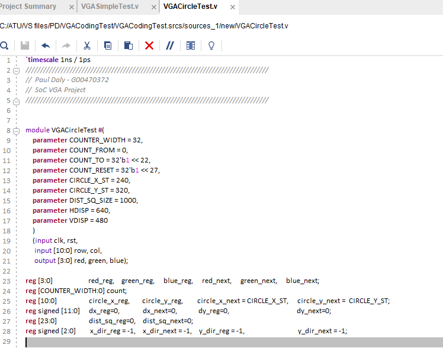
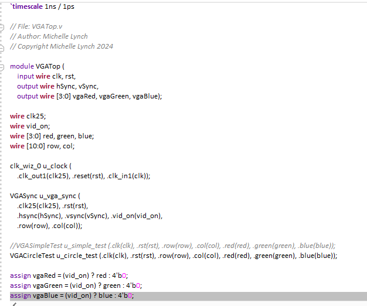

# Project Synopsis

Welcome to my development page for my project. This is a project to adapt an FPGA VGA driver to display graphics on to a display.

[Add a short welcome message or introduction here. Aim to get the viewer interested in what follows! Guideline: 1 or 2 sentences. ]

## **Template VGA Design**

### **Project Set-Up**

Summarise the project set-up and design flow. Include a screenshot of your own set-up, for example see the image of my Project Summary window below. Guideline 1 short paragraph.

### **Template Code**

Outline the structure and design of the Verilog code templates you were given. What do they do? Include reference to how a VGA interface works. Guideline: 2/3 short paragraphs, consider including screenshot(s).

### **Simulation**

Explain the simulation process. Reference any important details, include a well-selected screenshot of the simulation. Guideline: 1/2 short paragraphs.
### **Synthesis**
Describe the synthesis and implementation processes. Consider including 1/2 useful screenshot(s). Guideline: 1/2 short paragraphs.
### **Demonstration**
Perhaps add a picture of your demo. Guideline: 1/2 sentences.

## **My VGA Design Edit**

Introduce your own design idea. Consider how complex/achievabble this might be or otherwise. Reference any research you do online (use hyperlinks).

### **Code Adaptation**

Briefly show how you changed the template code to display a different image. Demonstrate your understanding. Guideline: 1-2 short paragraphs.

### **Simulation**

Show how you simulated your own design. Are there any things to note? Demonstrate your understanding. Add a screenshot. Guideline: 1-2 short paragraphs.

### **Synthesis**

Describe the synthesis & implementation outputs for your design, are there any differences to that of the original design? Guideline 1-2 short paragraphs.

### **Demonstration**

If you get your own design working on the Basys3 board, take a picture! Guideline: 1-2 sentences.

## Pictures WIP

Above: Combinational Logic of my verilog file

Above: Sequential Logic of my verilog file

Above: Start of my verilog file showing declarations for registers, variables and constants

Above: Expanded Logic Diagram of Project

Above: Expanded Logic Diagram of Template

Above: Overview of Logic Diagram of Project

Above: Project Summary

Above: Overview of Synthesis/Implementation (which?)

Above: Picture of components in S/I

Above: D Flip Flop

Above: Synthesis Picture (?)

Above: Picture of VGA Top, showing my verilog file being used to create an object

Above: Simulation of colour stripe testbench simulation, parameters have been adjusted to make the simulation easy to follow

Above: Expanded testbench to include colour changes, represented by characters in bit waveforms

Above: A simple square moving across the screen, utilizes a counter incremented with the clock

Above: A circle on screen, created using a square distance formula and comparing to the current row and col position
