# Project Synopsis

Welcome to my development page for my project. This is a project to adapt an FPGA VGA driver to display graphics on to a display.

I will be attempting to create a simple version of the DVD logo through Vivado, and will be going through the FPGA workflow that follows.

## **Template VGA Design**

### **Project Set-Up**

My project is built on top of template drivers. These templates have modules coded to synchronize the display code with the VGA vertical and horizontal sync, as well as handling the outputs. A clock module is implemented, with a frequency of 25MHz which is the required frequency for this driver.

Above: Project Summary

Above: Architectural Diagram of template project

Above: Elaborated Design of template project

### **Template Code**

The way a display works is by displaying each pixel at a time, column by column and row by row, from top left to bottom right. This is done 60 times a second, creating a 60Hz image. This is the standard for visual displays, and a standard our project must follow. This is handled by incrementing different parameters with respect to other parameters, for example resetting the column variable once it has reached the horizontal limit and incrementing row every time this occurs. 

VGASync handles the vsync/hsync system while providing row and column count to other modules, so that the colour of the current pixel can be controlled. VGATop is the main module, where the other modules are instantiated. ColourStripe handles the display logic, controlling pixel colour, taking input from other modules to do so. This is done using combinational logic to decide colour output (setting colour_next) and using sequential logic to assign colour values to registers (using colour_reg and colour_next).

 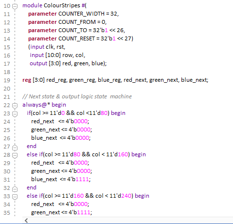 

Above: The code files in the template project

### **Simulation**

The project is simulated using a testbench, this is a file that uses the coded modules while simulating clocks or inputs. Testbenchs simulate a very small timeframe, due to the immense computational power required to simulate real hardware for long time periods. VGA syncing works with over hundreds of rows and columns, this makes it impossible to see everything in this small timeframe, so some parameters have been coded in as different values to the testbench to allow us to see the changes better. 

Notably the row and column limits have been reduced significantly. No colour changes can be seen in the first simulation as the row and column variables will never be large enough for ColourStripe to change these values, the second simulation has a module adjusted to change some colours with respect to the lower limit parameters. 

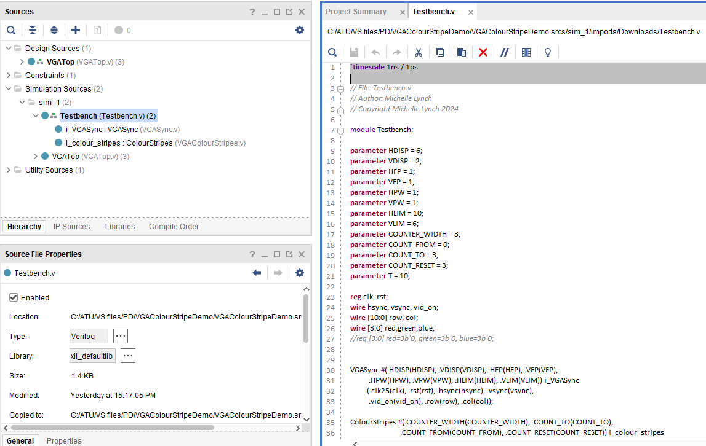

Above: Coded testbench file for template

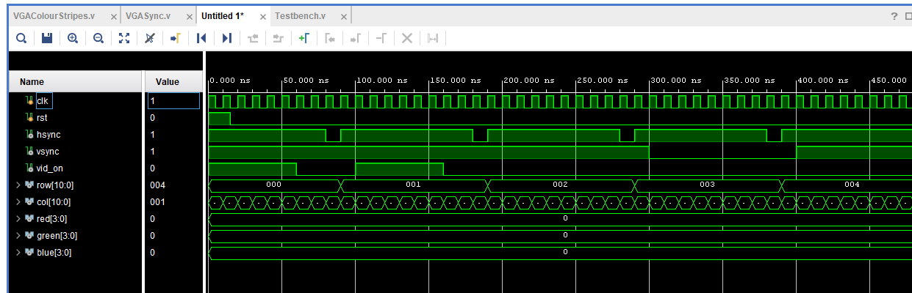

Above: Testbench simulation for ColourStripe

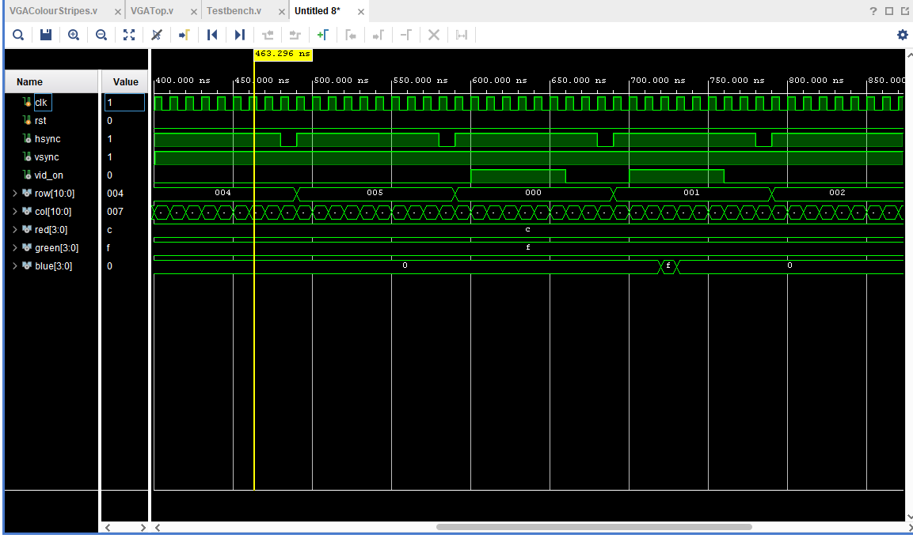

Above: Expanded testbench to include colour changes, represented by characters in bit waveforms

### **Synthesis**

Synthesis and Implementation processes are the design steps of implementing the code into hardware. An elaborated design is generated first, applying logic gates and other digital components to the module code, this design is a higher level of abstraction.

This synthesized design is then implemented into the actual SoC, using the various components available, such as multiplexers, lookup tables and D Flip Flops.

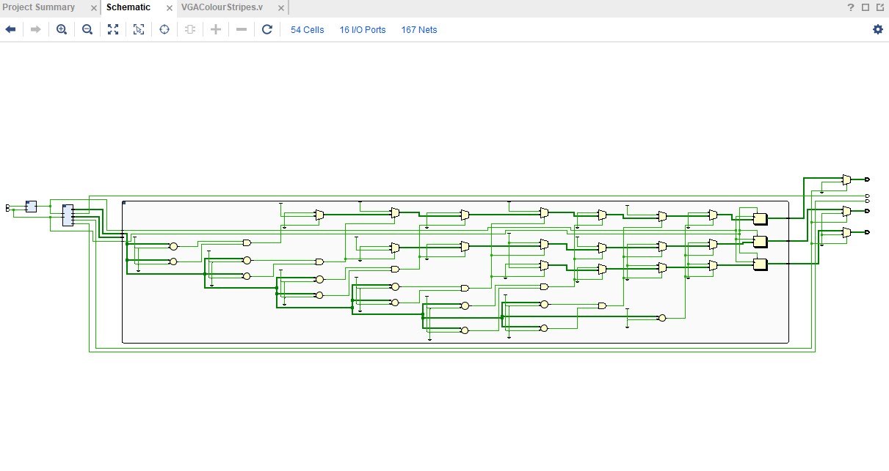

Above: Elaborated Design of template project, modules have been expanded

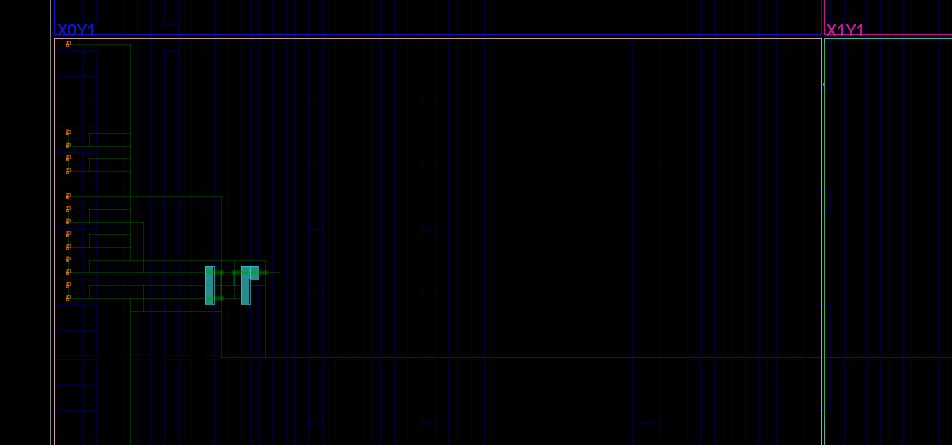

Above: Implemented Design of template project

### **Demonstration**

The output of this template project, a range of colours on different column ranges displayed through VGA.

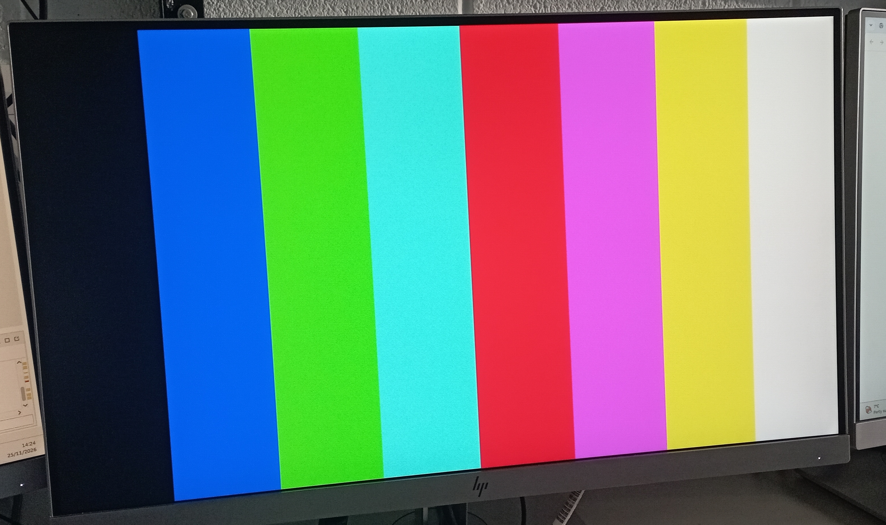

Above: ColourStripe demo

<video width="640" height="480" controls muted loop src="https://raw.githubusercontent.com/Paul-Daly366/SoC-VGA-Project-PD/refs/heads/main/docs/assets/images/ColourCycleDemo.mp4"> </video>

Above: ColourCycle demo

## **My VGA Design Edit**

For my project, I decided to replicate the iconic DVD screensaver. This is a simple screensaver on DVD devices that activates when the device enters idle or sleep mode, helping to reduce the issue of screen-burn in. To achieve this: I learnt to change pixel colour, create a simple shape, use a counter to move the shape, and figure out how to make the moving image change direction based on its position.

Some of these were more difficult than others. The counter in particular took a while to get working properly, as I had to make sure the incrementing worked as intended, and that the position logic was implemented correctly in the combinational and sequential logic sections. The bouncing was tricky to figure out and to implement, and took a bit of time to get right.

### **Code Adaptation**

I created a circle shape using a squared distance formula, comparing that with the current x y position. If the distance is less than the radius of the circle, change colour to create the circle.

I then coded movement by adding in a counter that increments with the clock, which adds to the xy position of the circle when it reaches a certain value (COUNT_TO in the picture). When adding this functionality in, the xy position of the circle had to be handled like a register, so handling the value in sequential logic.

After that, I coded in the bounce. This was done with a register variable that controlled which direction to move the circle (by adding or taking away from the circle xy position), these direction variables where changed when the x or y position of the circle gets too close to an edge of the screen. This works as intended but is a bit inaccurate, getting the values to compare to correct took some trial and error.

 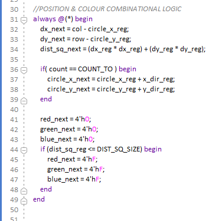 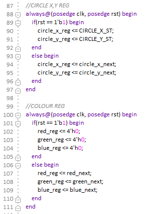 

Above: Code snippets from my design file

### **Simulation**

I adapted the testbench from the template code to work with my project. I didn't have to change too much, just adding the testbench as a simulation source file and changing a line of code to use the circle test module.

The simulation is similar to the template, shows a colour change occuring and shows hsync and vsync changing alongside the rows and columns.

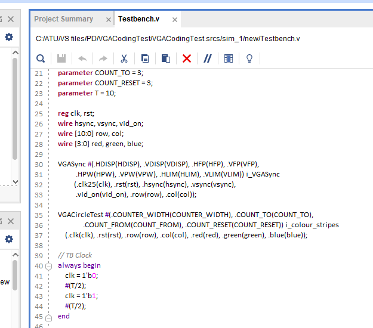

Above: Testbench file of project

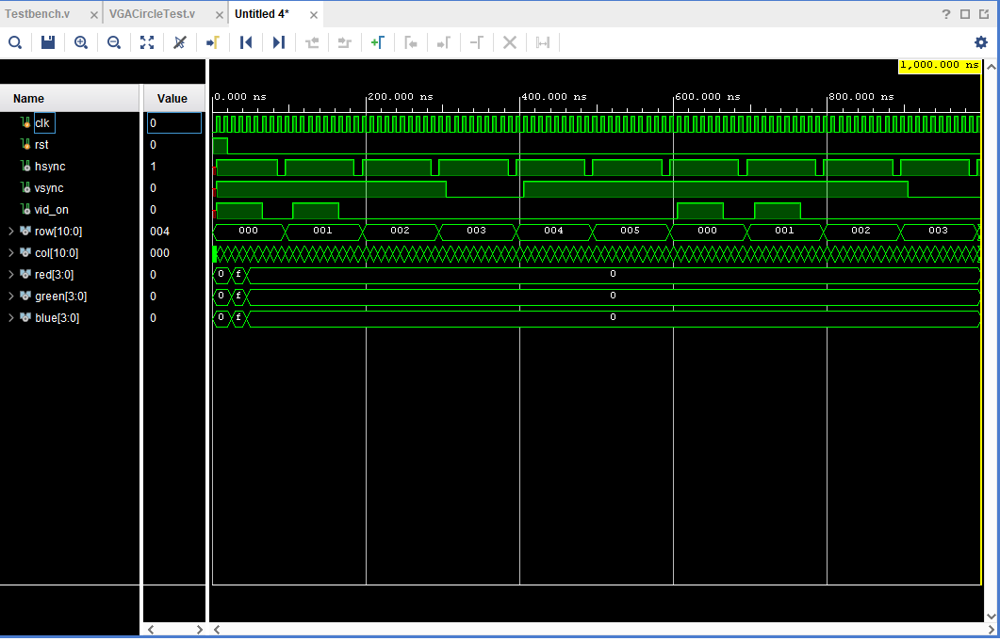

Above: Simulation of my project, this particular design code only has black (0) or white (f), which can be seen in the start

### **Synthesis**

Synthesis step creates an elaborated design from the code using logic gates and registers, implementation applies it to the actual hardware using the components on the SoC such as multiplexers or registers.

One big difference I noticed, there is a lot more registers used in my project compared to the template. This isn't too surprising as a lot of the display logic works on different registers, for example the x and y positions of the circle are saved in registers.

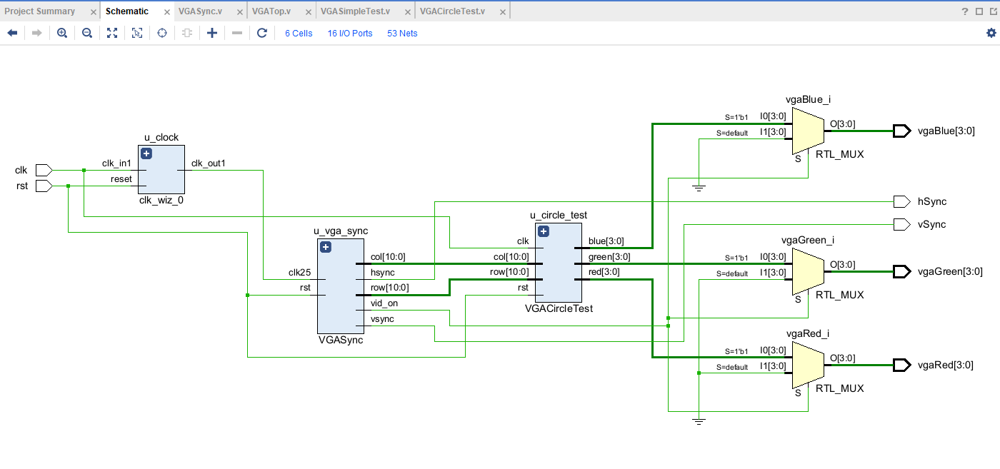

Above: Elaborated Design of my project

Above: Elaborated Design of my project, modules have been expanded

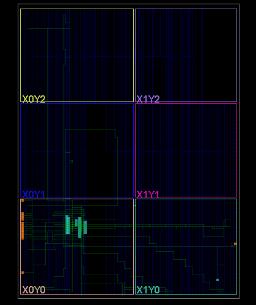

Above: Overview of Implemented Design

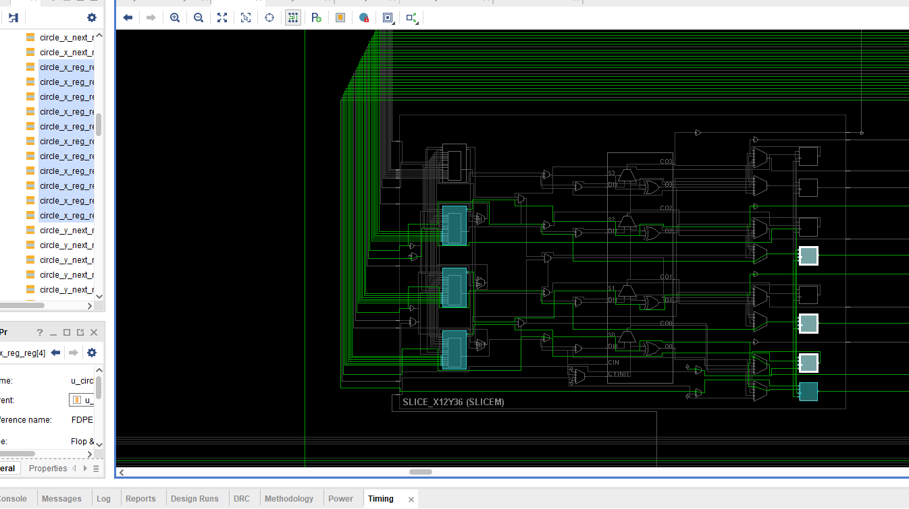

Above: Zoomed in on some components

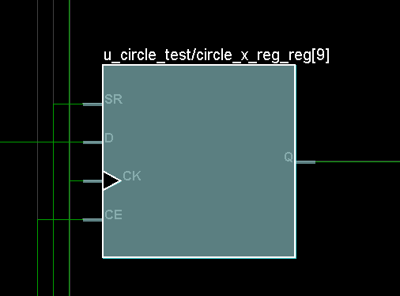

Above: D Flip Flop used to store the x position of the circle

### **Demonstration**

Here are some finished outputs from the project.

Above: A simple square moving across the screen, utilizes a counter incremented with the clock

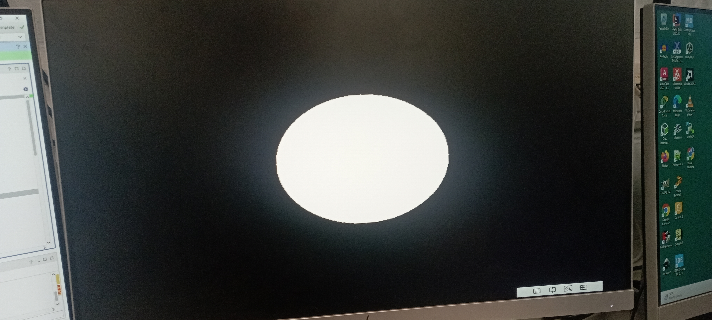

Above: A circle on screen, created using a square distance formula and comparing to the current row and col position

<video width="640" height="480" controls muted loop src="https://raw.githubusercontent.com/Paul-Daly366/SoC-VGA-Project-PD/refs/heads/main/docs/assets/images/CircleBounce.mp4"> </video>

Above: Video of circle bouncing on edges of screen, though the edges are bit inaccurate

